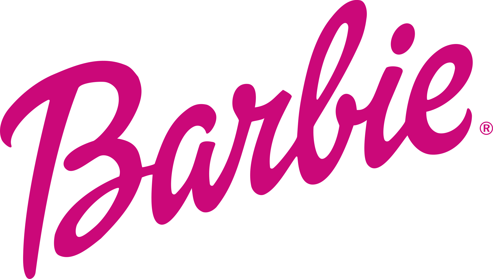

<div align="center">



# 💗 BARBIE'S DREAMHOUSE 🏡

### ✨ Your dream world. Your rules. Your imagination. ✨

An interactive 3D Barbie Dreamhouse built with **Three.js**, featuring immersive dollhouse exploration, interactive furniture, and optional AI-powered hand gesture controls using MediaPipe.

<br/>

<a href="https://barbie--dream.vercel.app/">
  
</a>

<br/><br/>


<br/>

**A little pink. A little magic. A whole lot of imagination.**

</div>

---

## 🎀 Welcome to the Dreamhouse

Step inside a colourful, interactive 3D dollhouse where you can explore rooms, interact with furniture, change the lighting, and experience a new way of navigating a virtual world.

This project combines real-time 3D graphics with computer vision to bring hands-free interaction into a playful Barbie-inspired environment.

### ✨ Features

| Feature                    | Description                                                             |
| -------------------------- | ----------------------------------------------------------------------- |
| 🏡 Interactive 3D House    | Explore a detailed dollhouse environment powered by Three.js.           |
| 🪑 Interactive Furniture   | Select objects and explore different parts of the house.                |
| 🌞 Day & Night Mode        | Switch between lighting environments.                                   |
| ✋ Hand Gesture Controls    | Navigate the experience using your webcam.                              |
| 📷 Local Camera Processing | Hand tracking runs locally in your browser after permission is granted. |
| 💖 Multiple Controls       | Mouse, touch, keyboard and gesture-based interaction.                   |

---

## 💅 A Little Magic — Hands-free Exploring

Why use a mouse when you can use your hands?

The Dreamhouse includes optional webcam-based hand tracking powered by Google's MediaPipe Hand Landmarker.

**Your camera stays off until you explicitly enable gesture controls.**

### 🖐️ Gesture Guide

| Gesture                                               | Action                                          |
| ----------------------------------------------------- | ----------------------------------------------- |
| 🖐️ Open palm + movement                              | Rotate the Dreamhouse camera                    |
| 🤏 Pinch                                              | Select an object under the mirrored hand cursor |
| ✋ Hold a steady open palm for approximately 2 seconds | Reset the camera view                           |
| 👍 Thumbs up                                          | Toggle day/night lighting                       |

**A few interaction details:**

* Pinches trigger once until released.
* Camera movement is smoothed and capped.
* Reduced-motion preferences disable automatic hand-motion response.
* Traditional controls remain available while gesture mode is active.

---

## 🛠️ Built With

<div align="center">


</div>

* **Three.js** — Real-time 3D rendering.
* **JavaScript (ES Modules)** — Application logic.
* **Vite** — Development and production build tooling.
* **MediaPipe Tasks Vision** — Hand landmark detection.
* **Web Workers** — Background hand-tracking inference.
* **WebRTC / getUserMedia** — Webcam access.

---

## 🚀 Getting Started

Want to explore the Dreamhouse locally?

### Prerequisites

* Node.js
* npm
* A modern browser
* Webcam for optional gesture controls

### Installation

Clone the repository:

```bash
git clone https://github.com/metadore/barbie-_-dream.git
```

Navigate into the project:

```bash
cd barbie-_-dream
```

Install dependencies:

```bash
npm install
```

Start the development server:

```bash
npm run dev
```

Open the local URL displayed in your terminal, usually:

```text
http://localhost:5173/
```

### Production Build

To generate the production bundle:

```bash
npm run build
```

To preview the production build locally:

```bash
npm run preview
```

---

## ⚙️ How MediaPipe Works

The app uses Google's official `@mediapipe/tasks-vision` Hand Landmarker in `VIDEO` mode.

The implementation:

* Loads the version-pinned MediaPipe vision bundle and WASM runtime lazily from jsDelivr.
* Uses a classic worker so the WASM bootstrap can register the `ModuleFactory` expected by the vision runtime.
* Attempts GPU delegation first and falls back to CPU if GPU setup is unavailable.
* Fetches the official hand-landmarker model from Google Cloud Storage.
* Uses transferable `ImageBitmap` frames to keep inference away from the main rendering thread.

### Performance

| Setting             | Configuration                           |
| ------------------- | --------------------------------------- |
| Inference frequency | Approximately 20 FPS                    |
| Webcam resolution   | Up to 640 × 480                         |
| Webcam frame rate   | Up to 24 FPS                            |
| Processing          | Web Worker                              |
| GPU                 | Supported devices, with CPU fallback    |
| Background tabs     | Inference pauses when the tab is hidden |

Actual performance depends on the browser and hardware.

---

## 🔒 Privacy First

Your camera. Your control.

* Camera access is disabled by default.
* Webcam permission is requested only after selecting **Enable gesture controls**.
* Video frames and hand landmarks are processed locally in your browser.
* Camera frames are not uploaded, recorded, or stored by the application.
* MediaPipe's model and WASM runtime are downloaded from public hosts when required.
* Selecting **Turn camera off** stops every camera track and disposes of the hand-tracking worker.

Camera access requires browser permission and either `localhost` or a secure HTTPS origin.

If permission is denied, no camera is available, or another application is using it, the panel provides an explanation and retry option.

---

## 🌸 Project Preview

<div align="center">

### Step inside. Explore. Play. Imagine.

**A virtual dreamhouse designed to bring a little extra magic to the browser.**

<a href="https://barbie--dream.vercel.app/">
  
</a>

</div>

---

## 🧪 Validation

Run the following command to validate the production bundle:

```bash
npm run build
```

Gesture geometry can be checked without a camera.

However, successful live landmark detection and physical gesture behaviour require a real webcam and testing on the target browser/device.

No hardware-camera test is claimed by this project report.

---

<div align="center">


### 💗 Made with imagination, creativity & a little bit of pink magic.

**BARBIE'S DREAMHOUSE**

*Because every dream deserves a beautiful home.* 🏡

</div>
